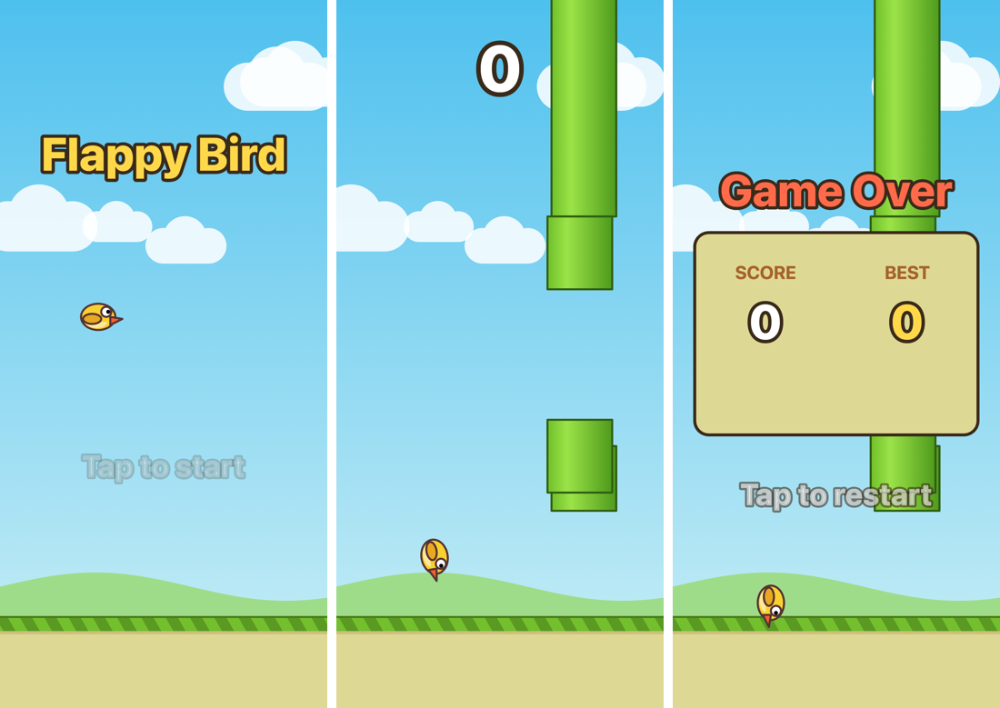

# Flappy Bird contest: Flint, MTPLX and Sonnet 5.5 (2026-11-24)

Each setup is asked to build a Flappy Bird game for phones as one `index.html`, from the same prompt, by itself, with
nothing else running. Flint and MTPLX serve Inkling 2 Mini locally and run in pi, as in the
[weather contest](weather-app-contest). Sonnet 5.5 runs in Claude Code (`claude -p`) over the API, as a cloud reference
point: a different model and a different harness, so read it as a yardstick, not as an engine result.
One run each on one machine; see the disclaimer on the [home page](../).

## The task and the gate

The prompt ([`prompt.txt`](https://github.com/gAmUssA/agent-bench/blob/main/agent-bench/flappy/prompt.txt)) asks for a
self-contained page that fills a portrait phone screen, flaps on any tap, has ready, playing and game-over screens, and
exposes `window.game` (state, score, bird, pipes) for the checker.

The supervisor keeps going until the gate passes (12 rounds or 3 hours at most). The gate opens the page in Chrome with a
390x844 touch viewport and requires: no external requests, no JavaScript errors, no scrolling, a tap that starts play, an
animating frame, game over when left alone, a tap that restarts, and a simple bot that passes at least one pipe.

## Results

| | Flint | MTPLX | Sonnet 5.5 |
|---|---|---|---|
| Model and harness | Inkling 2 Mini, pi | Inkling 2 Mini, pi | Sonnet 5.5, Claude Code |
| Gate | passed | passed | passed |
| Rounds needed | 1 | 1 | 1 |
| Wall time | 255 s (4 min) | 458 s (8 min) | 106 s |
| Model turns | 14 | 16 | 6 |
| Tool calls | 14 | 15 | 2 |
| Output tokens | 26,529 | 23,896 | 19,088 |
| index.html | 408 lines | 504 lines | 348 lines |

Turns and tool calls are counted from each harness's own session log, so they are comparable in size, not exactly in meaning.
These are Flint's second run. Its first run (2 rounds, 605 s) passed an earlier gate while drawing only sky and clouds, so the gate was tightened to require a visible bird and Flint was rerun. The first run's page is kept in the repository history, not hosted.

## Play them

The three games, exactly as each model wrote them, with no edits. Open them on a phone:
[Flint](../demos/flappy/flint/), [MTPLX](../demos/flappy/mtplx/) and
[Sonnet 5.5](../demos/flappy/sonnet/).

## What each one built

Each strip shows the ready screen, a frame during play and the game-over screen, captured by the gate.

**Flint** (second run):

**MTPLX**:

**Sonnet 5.5**:

My reading of the screenshots:

- **Flint:** complete and readable: clouds, bird, pipes with caps, ground, a score and a restart prompt. The ready-screen prompt overlaps the bird slightly, and the game-over screen lacks a score card, so it is the plainest of the three.
- **MTPLX:** clean and complete: sun, clouds, bird, pipe with caps, ground, readable overlays.
- **Sonnet 5.5:** the most polished (hills, striped ground, score card). One flaw: a pipe's cap sits offset from its body.

None of the three was played by a person; the games were judged from gate screenshots and the bot.

## Other contest

The same setups also built a native macOS app in the [weather-app contest](weather-app-contest).

## Caveats

- One run per setup. Three or more runs are needed before ranking anyone.
- The gate is a floor, not a grade. It now checks that the bird is drawn where the hook says, but it cannot judge looks or feel. MTPLX and Sonnet were rechecked against the tightened gate and still pass.
- The machine had heavy swap in use during these runs, which can lengthen local wall times.
- Re-run it: `TASK=flappy bash agent-bench/weather/contest.sh flint mtplx sonnet`.
