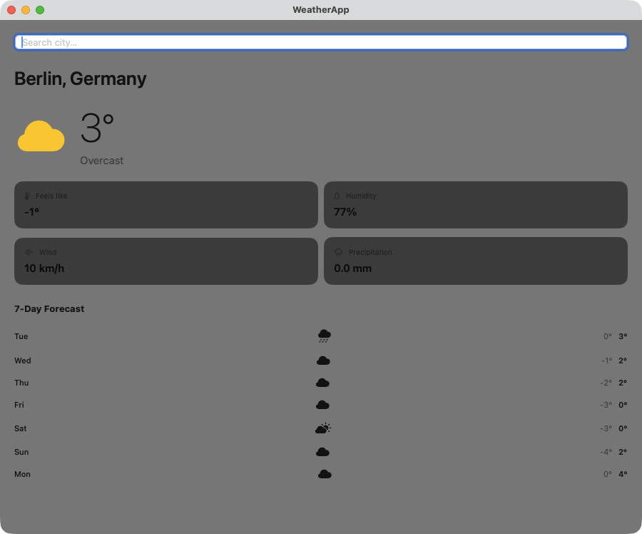
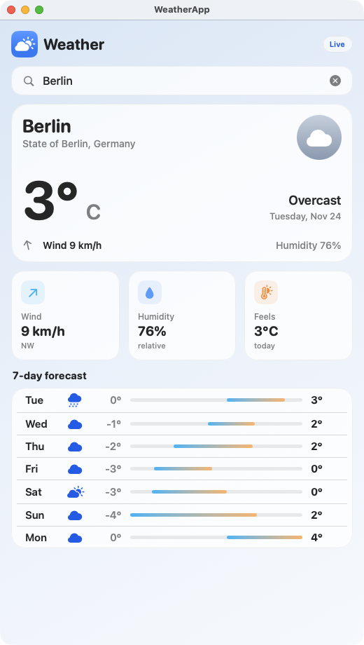
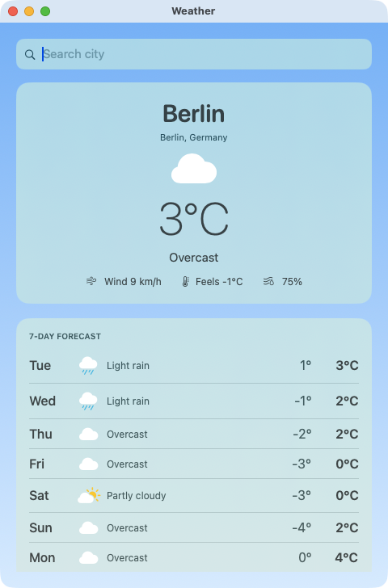
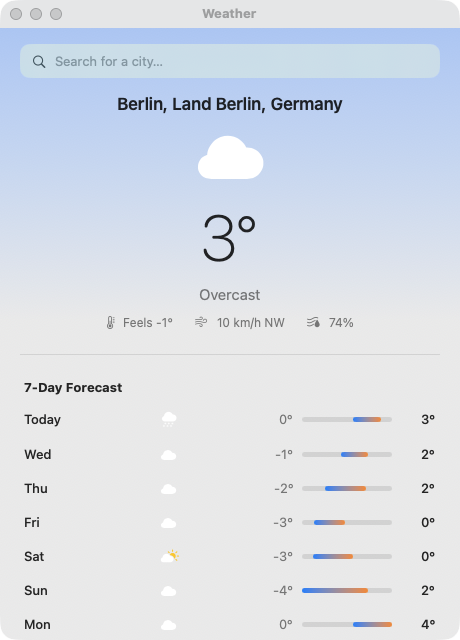
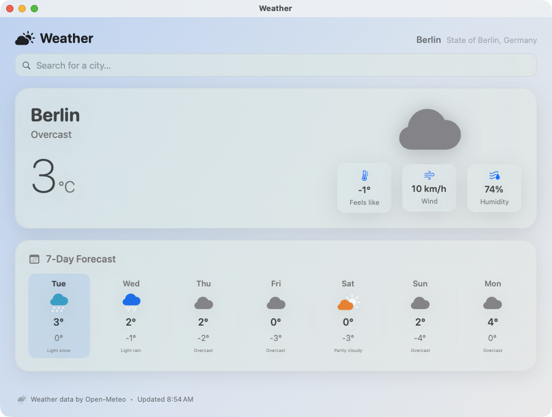

# Weather-app contest: five setups (2026-11-24)

The same model (Inkling 2 Mini), the same prompt and the same coding harness (pi), served by the two fastest engines
from the [setup comparison](inkling-2-mini-m5-max-studio). Each one is asked to build a native macOS weather app,
alone, with nothing else running. Three cloud models were added afterwards as reference points: Sonnet 5.5 in Claude Code (`claude -p`), and Ember-1 and DeepSeek V4.1 Flash on the Fireworks API, both in pi. They are different models, so they are yardsticks rather than engine results. Results are one run per setup on one machine; see the disclaimer on the [home page](../).

## The task

The prompt ([`prompt.txt`](https://github.com/gAmUssA/agent-bench/blob/main/agent-bench/weather/prompt.txt)) asks for a
SwiftUI app built with SwiftPM: Open-Meteo geocoding and forecast, Berlin in °C by default, a 7-day forecast with weekday
names, a city search field, error handling, and a polished look in light and dark.

The harness does not stop until the app works. A supervisor reruns `pi -p` (resuming the same session) until a
deterministic gate passes, up to 12 rounds or 3 hours. The gate builds the package, launches the executable, screenshots
its window, reads the text with Vision OCR and passes only when the window shows Berlin's live temperature
(within 1.5 °C of Open-Meteo) and at least 5 weekday names. When it fails, its message goes back to the model as the next prompt.

Runs were sequential: all other servers and harnesses were stopped before each engine started.

## Results

| | Flint | MTPLX | Sonnet 5.5 | Ember-1 | DeepSeek V4.1 Flash |
|---|---|---|---|---|---|
| Model and harness | Inkling 2 Mini, pi | Inkling 2 Mini, pi | Sonnet 5.5, Claude Code | Ember-1, pi | DeepSeek V4.1 Flash, pi |
| Where it runs | Local (Flint) | Local (MTPLX) | Cloud (Anthropic API) | Cloud (Fireworks API) | Cloud (Fireworks API) |
| Gate | passed | passed | passed | passed | passed |
| Rounds needed | 3 | 1 | 1 | 1 | 1 |
| Wall time | 2750 s (46 min) | 720 s (12 min) | 75 s | 175 s (3 min) | 440 s (7 min) |
| Model turns | 165 | 71 | 10 | 26 | 57 |
| Tool calls | 183 | 70 | 6 | 27 | 68 |
| Output tokens | 96,846 | 41,220 | 8,694 | 8,499 | 35,784 |
| Swift code written | 532 lines, 4 files | 846 lines, 6 files | 316 lines, 4 files | 555 lines | 859 lines |
| **Cost of the run** | **$0** (local) | **$0** (local) | **$0.12** | **$0.35** | **$0.08** |

Flint's first round ended with a window that showed one weekday name, its second with four. The gate's message named the
miss, and round 3 fixed it. Every other setup passed on the first round.

## Cost

Local runs cost nothing in API fees; the electricity the Mac used is not counted. Sonnet 5.5's figure is the total Claude Code reported for the session. The Fireworks figures are pi's accounting from each model's listed per-token price at the time of the run. Both count one session of one run, so treat them as an order of magnitude.

## What each one built

<div class="shots">
<figure><figcaption>Flint: functional, plain, gray background.</figcaption></figure>
<figure><figcaption>MTPLX: header, hero card, range bars.</figcaption></figure>
<figure><figcaption>Sonnet 5.5: glass cards, conditions per day.</figcaption></figure>
<figure><figcaption>Ember-1: compact list with range bars.</figcaption></figure>
<figure><figcaption>DeepSeek V4.1 Flash: hero card and day cards.</figcaption></figure>
</div>

All five show Berlin at 3 °C, which matches Open-Meteo at gate time. I did not exercise the city search in either app:
driving it needs UI scripting, which was not enabled. The gate checks only the default view, so treat search as unverified.

## Supervisor log, Flint

```
06:10:35 round 1: pi -p (timeout 2700s)
06:43:45 round 1: pi exited 0
06:43:59 gate failed: the window shows 1 distinct weekday name; at least 5 required
06:43:59 round 2
06:49:07 round 2: pi exited 0
06:49:19 gate failed: the window shows 4 distinct weekday names; at least 5 required
06:49:19 round 3
06:56:12 round 3: pi exited 0
06:56:25 gate passed: 7 weekday names, live temperature near 2.7 C
06:56:25 result: passed after 3 rounds, 2750 s
```

## Next contest

The same setups also built a mobile [Flappy Bird game](flappy-bird-contest), with playable pages.

## Caveats

- One run per engine. Model runs vary; three or more runs are needed before ranking anyone on this.
- The machine had about 17 to 26 GB of swap in use during the contest (see the [setup comparison](inkling-2-mini-m5-max-studio)), which can lengthen wall times.
- Look quality is my reading of two screenshots, not a measurement. Rounds, turns and tokens are counted.
- Re-run it yourself: [`agent-bench/weather/contest.sh`](https://github.com/gAmUssA/agent-bench/blob/main/agent-bench/weather/contest.sh).
